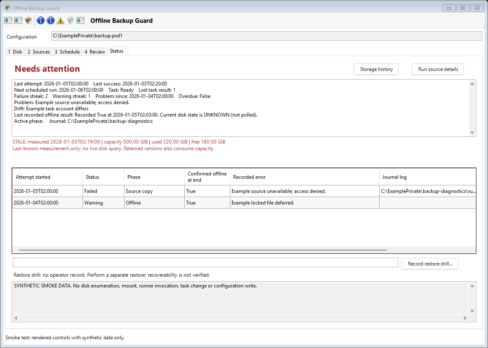

# Offline Backup Guard

**A Windows file-backup toolkit for scheduled, canary-checked copies to a dedicated USB disk, with recovery retention and offline-readable reports.**

This is a reusable reference implementation, not a managed backup product. All
examples are fictional. There are no organization-specific integrations, network
maps, production configurations, credentials, or operational records in this repository.

> **Software-offline is not a physical air gap.** An administrator or privileged
> malware can bring an attached disk online. A canary is only a change signal,
> not a ransomware detector. Keep independent offline or immutable backups and
> test restores. Do not make this your only recovery path.

## What it does

- Reads an editable CSV source list. No reinstall needed when folders change.
- Checks a pinned host canary and optional source canaries before mounting.
- Matches a dedicated USB disk by serial number; rejects system and boot disks.
- Uses Robocopy for incremental file copies; per-source mirroring is optional.
- Retains previous destination files before planned replacement or deletion.
- Skips preflight-detected sharing locks for that run; retries them next run.
- Keeps non-lock I/O errors fatal and enforces optional deletion-count limits.
- Attempts to offline the disk in `finally`, including failed copy runs.
- Writes local JSON/Markdown reports with capacity, remaining space, timestamps,
  per-source results and retained-file counts; at most one storage point per day.

No cloud connection, email integration, telemetry, automatic privilege elevation,
or background monitoring service is included. Task installation is an explicit,
confirmed wizard action through Windows UAC. Reports stay readable when the disk is offline.

## Setup wizard and health view

On Windows, double-click `Start-BackupGuard.cmd`, or launch the English native
desktop interface from PowerShell:

```powershell
powershell.exe -NoProfile -STA -File .\Start-BackupGuard.ps1
```

The wizard walks through the dedicated disk identity, source folders, schedule,
account and review. It can load an existing configuration, save backed-up edits,
run read-only preflight, start an explicitly requested test, and register a Windows
task after confirmation. Passwords are entered through Windows and are never
written into configuration files. Interactive task mode requires that user to
remain logged in; an unattended account needs appropriate rights and acceptance
in its actual execution context.

The status view reads durable journals and Windows Task Scheduler without mounting
the backup disk. It distinguishes warnings, failures, interrupted runners and
missed daily starts. It shows the last attempt/success, failure streak and first
failure, next scheduled run, task configuration drift, logs and timestamped free
capacity. A manual size estimate reads only the selected sources; unreadable or
excluded regions make it incomplete, not a guaranteed space requirement.

See [the desktop guide](docs/DESKTOP.md) for setup, diagnostics and acceptance limits.



The screenshot uses synthetic examples, not a running installation.

## Quick start

Requirements: Windows with Windows PowerShell 5.1 or PowerShell 7, Robocopy, the
Storage module, and a dedicated, already formatted USB disk with one data partition
larger than 1 GiB. Disk operations require an approved elevated account. The same
account must have access to every source; `SYSTEM` usually cannot read user shares.

1. Download or clone this repository to a trusted local folder. Follow your
   organization's script-signing and execution-policy requirements. Do not disable
   endpoint protection or bypass a blocked script.
2. Copy `config/backup.example.psd1` and `config/sources.example.csv` to your private
   configuration directory. Replace every example path and disk identifier.
3. Select only data approved for backup. Initially use a disposable source and disk.
   The example sources are disabled and `ReadyForUse` is false by design.
4. Create a canary, pin its trusted text/hash, then enable one test source. Never
   automatically relearn canary hashes from possibly compromised files.
5. Run read-only preflight, then an explicitly requested manual test:

```powershell
# Inspect identity only; this does not format or mount anything.
Get-Disk | Select-Object Number, FriendlyName, SerialNumber, BusType, IsBoot, IsSystem, IsOffline

# Example canary; create it once in your private configuration directory.
$text = 'Backup integrity sentinel. Do not edit.'
[IO.File]::WriteAllText('C:\BackupGuard\canary.txt', $text, [Text.UTF8Encoding]::new($false))
Get-FileHash -LiteralPath 'C:\BackupGuard\canary.txt' -Algorithm SHA256

# After editing the private PSD1 and CSV and setting ReadyForUse = $true:
.\src\Run-Backup.ps1 -ConfigPath C:\BackupGuard\config\backup.psd1 -ValidateOnly
.\src\Run-Backup.ps1 -ConfigPath C:\BackupGuard\config\backup.psd1 -AllowManualRun
```

6. Verify the report, confirm the disk is offline, and restore a test file to a
   separate location. Only then schedule it using [the operations guide](docs/OPERATIONS.md).

**Mirroring deletes files.** With `MirrorDeletes=true`, a file removed from the
source is removed from `Current` after retention capture. Quarantine is finite
and is on the same disk. Retention expiry permanently deletes older recovery files.
Unreviewed mass changes can still damage a backup: keep an independent recovery copy.

## Configuration and results

| Setting | Purpose |
| --- | --- |
| `SourceListPath` | Private semicolon-separated CSV; one enabled source per row |
| `WindowStart`, `WindowEnd` | Permitted local-time **start** window; not a forced cutoff |
| `Canary` | Fixed local text and SHA-256 checked before mounting |
| `BackupDisk` | Exact USB identity, expected volume label, dedicated mount folder |
| `RetentionDays` | How long previous destination files remain in quarantine |
| `Threads` | Robocopy workers, 1-32; start with 8 |
| `ReportRoot`, `LogRoot` | Private locations outside the offline volume |

The disk contains `OfflineBackupGuard/Current/<alias>` and
`OfflineBackupGuard/Quarantine/<alias>/<run>`. These are generic application-owned
folders, not a model of any organization's infrastructure.

`latest.md` and `latest.json` describe the last completed validated backup invocation.
`daily/YYYY-MM-DD.*` retains one report per day; additional same-day invocations
replace that day's report. `storage-history.json` keeps the first measurement per
measurement day, up to 366 entries. Old values retain their original timestamp.
The runner publishes after copying, before exit; reading a report never probes
or mounts the disk. Every invocation also writes a run journal under a private
`<config-name>-diagnostics` directory beside its configuration. This captures
early configuration/preflight failures without trusting unvalidated report paths.
If even that directory cannot be written, console/task diagnostics remain the
fallback. Validation attempts do not count as successful backups.

### Previous file versions

New setups keep the **current backup plus one previous replacement version per
file**. Increase `PreviousVersions` per source (for example 3 or 10), or set it to
0 to disable replacement versioning for that source. Deleted-file recovery has a
separate `DeletedRetentionDays` setting, default 30 days. Turning off replacement
versions does not turn off deleted-file protection when mirroring is enabled.

A blank `PreviousVersions` preserves the original time-based `RetentionDays`
policy for existing configurations. Settings are not silently migrated. The GUI
requires confirmation before reductions. Pruning happens after successful copying,
not when you save settings; sharing-lock warnings defer pruning for that source.
Deleted-file protection, ambiguous timestamps or unsafe metadata may retain more
than the selected count. Retention warnings are visible and never silently ignored.
See [retention and recovery details](docs/OPERATIONS.md#retention-and-space).

Counts are conservative: this release reports retained/expired recovery files and
locks found at preflight or during copying. It does **not** label Robocopy preview
counts as actual files copied or deleted. Detailed diagnostics remain in private logs. No dashboard is required;
other monitoring tools can ingest the JSON without access to the backup contents.

## Why this can help radiotherapy BCM

Business continuity management (BCM) needs recoverable information, not merely a
green backup icon. A separately protected copy can help a radiotherapy team recover
approved QA procedures, commissioning reference documents, validated scripts,
configuration exports and continuity instructions during an outage. Prioritize
these with clinical, physics and IT owners, assign recovery objectives, and rehearse
restoration before an incident.

This repository does **not** back up a treatment-planning or oncology-information
system consistently by copying its live database files. Use vendor-supported
exports/backups and authorized recovery procedures. Restored clinical data must be
validated through local clinical and IT governance before care resumes. Patient
information requires appropriate access controls, encryption, retention and legal
approval. This tool is not a medical device, a clinical authorization, or evidence
of regulatory compliance.

[CISA recommends offline, encrypted backups and regular restoration tests](https://www.cisa.gov/stopransomware/ransomware-guide).
For exact copy and exit-code semantics, see [Microsoft's Robocopy reference](https://learn.microsoft.com/en-us/windows-server/administration/windows-commands/robocopy).
These are background references, not endorsements of this project.

## Safety, testing and contributions

- [Operations and restore drill](docs/OPERATIONS.md)
- [Threat model and security policy](SECURITY.md)
- [Release notes](CHANGELOG.md)
- [Contributing](CONTRIBUTING.md)
- [Banner provenance](assets/README.md)

```powershell
.\tests\Test-BackupGuard.ps1
```

Tests use temporary synthetic files and mocked disk discovery. They do not mount,
offline, format, or enumerate production backup contents. A real deployment still
needs a supervised hardware acceptance test and restore drill. No unattended
clinical deployment is claimed. Windows/Robocopy output in English and German is
handled by the inherited parser; other locales require validation.

MIT licensed. Review the code and adapt it to your environment before operational use.
