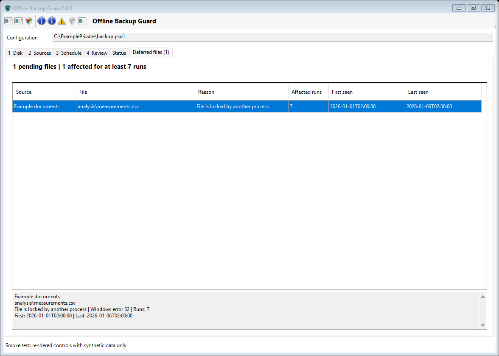

# Desktop setup and health

## Install and open the Windows app

Download **Setup.exe** from the assets of a v0.3.0 or later
[release](https://github.com/Kiragroh/offline-backup-guard/releases/latest), then
double-click it as your normal Windows user. You do not need to clone this
repository, compile anything or open a PowerShell terminal.

Setup adds **Offline Backup Guard** to your desktop and Start menu. The installer
offers startup at sign-in; this starts the tray app, not a backup. Open the app
from a shortcut to configure your disk, source folders, retention and schedule.
Installation alone never creates a scheduled backup job.

Closing the window hides it in the system tray. Use the tray menu or either
shortcut to reopen the same window with unsaved edits intact. Choose **Exit** in
the tray menu to stop the app; scheduled backup jobs remain independent.

The status screen shows the last attempt and successful backup, repeated
problems, logs, next run and timestamped storage figures. It reads saved reports
without mounting your backup disk. The [setup sequence](#setup-sequence) below
covers first-time configuration and testing.

## Deferred files

The **Deferred files (count)** tab and tray entry show individual files that could
not be updated, their reason, first/last observation and consecutive affected-run
count. Select a row for full details. The Status heading keeps the count visible.
These records remain readable when the backup disk is offline.

In **3 Schedule**, **Deferred-file warning after runs** defaults to seven. Runs
one through six stay green when nothing else requires attention; the seventh
affected run of the same file warns. A successful retry removes its pending entry.
This threshold is also stored as `DeferredWarningAfterRuns` in the private PSD1.
Changing it never converts historical failed runs into successes.

Directory failures, disk corruption/full disk, canary failures, interrupted jobs
and failed offline transitions still need attention immediately. A completed run
with pending files does not mean every file is current. See
[recovery diagnostics](RECOVERY-DIAGNOSTICS.md) for filesystem-repair boundaries.



The installer is currently unsigned. Follow local approval and signing policies;
do not bypass a Windows or endpoint-protection block.

## Deployment boundary

The desktop is a local Windows Forms application using Windows PowerShell 5.1.
The compiled .NET Framework entry point hosts the existing Windows PowerShell 5.1
editor in a separate process, with normal execution-policy enforcement. No browser,
web listener, cloud service or Windows service is installed. The optional tray app
runs until explicitly exited and refreshes recorded health every 30 seconds.
The backup runner remains usable without the GUI. Closing the window hides it,
even during a GUI operation; tray **Exit** waits for an active GUI operation and
asks before discarding unsaved edits. Scheduled backups are independent and are
never stopped by closing or exiting the app. Windows shutdown is not cancelled
by the close-to-tray handler; it does not guarantee completion of an active backup.
Never force-stop a runner without an offline recovery procedure.

## Build from source (developers)

Skip this section when installing the release's **Setup.exe**. These instructions
are for contributors who want to compile their own package.

Run from a trusted checkout using Windows PowerShell, without an execution-policy
bypass. The build reads the repository `VERSION`; .NET Framework's C# compiler,
Windows Forms and Windows PowerShell 5.1 must already be available.

```powershell
powershell.exe -NoProfile -File .\Build-Desktop.ps1
.\dist\desktop\Setup.exe
```

Setup is a self-contained Windows EXE with an embedded payload. Installation is
per user under `%LOCALAPPDATA%\Programs\OfflineBackupGuard\versions\<version>`.
Shortcuts target the installed `Desktop.exe`, not a shell or browser bridge.
The login-startup checkbox is checked on first install and preserves the existing
choice on upgrades. Installing is the explicit confirmation; uncheck it to decline.
Only the app's HKCU Run entry is configured, never a scheduled backup task.
For unattended installation explicitly choose one of:

```powershell
Setup.exe --install --startup
Setup.exe --install --no-startup
Setup.exe --uninstall --quiet
Desktop.exe --tray
```

Command-line setup returns 0 on success and 1 on failure. Failures are recorded in
`%LOCALAPPDATA%\OfflineBackupGuard\desktop-logs`; interactive failures also display
a message. The public app and all setup operations refuse elevation. The backup
editor's existing explicit UAC actions remain available.

Configuration remains outside installed versions, by default at
`%LOCALAPPDATA%\OfflineBackupGuard\config\backup.psd1`. Setup does not create,
rewrite or migrate configuration. Versions are immutable, downgrade is rejected,
and a changed same-version build cannot replace a previous package. Keep the exact
installer used for a version: the framework compiler does not promise byte-identical
rebuilds. Old version folders are retained because existing scheduled tasks may
reference them. Updating the desktop does not retarget a scheduled backup task.

Use Windows Installed Apps or the Start menu **Uninstall** shortcut to remove
desktop/Start menu shortcuts, login startup and uninstall registration. Uninstall
deliberately retains versioned runners, configuration, logs, scheduled tasks and
backup data. Archive/remove an old version manually only after proving no scheduled
task references it. A renamed or user-modified shortcut/startup registration causes
setup to fail closed rather than overwrite unrelated integration.

The installer stages and verifies files, copies into the final version directory,
then atomically replaces `current.json`; it never renames a directory containing
executables. A same-package `installing.txt` marker permits retry of an interrupted
copy. An unmarked incomplete/conflicting folder is not silently deleted or adopted.
Files are hash-verified before activation and again at native launch. These hashes
detect corruption, not publisher authenticity: artifacts are unsigned unless the
distributor signs them. Verify trusted release hashes/signatures independently;
do not bypass SmartScreen, execution policy or endpoint protection. A per-user
writable installation is not a trust boundary against that user or an administrator.

## Reusing the native package

The MIT-licensed `desktop/Common.cs`, `Launcher.cs`, `Setup.cs`,
`New-DesktopIcon.ps1` and `Build-Desktop.ps1` are brand-neutral source files.
Copy their MIT `LICENSE` with them. Keep a private/internal profile outside this
repository and call:

```powershell
.\Build-Desktop.ps1 -PackageRoot C:\ExampleApp -EntryScript Start-App.ps1 `
  -PackagePaths @('src','assets') -Name 'Example Backup' -AppId ExampleBackup `
  -Version 1.0.0 -OutputDirectory C:\ExampleBuild
```

`PackagePaths` is an explicit relative file/directory allowlist, recursively copied;
the entry script, generated `assets/desktop/*.ico` and MIT license are automatic.
Avoid broad directory selections containing private configuration. Output must be
empty. Outputs include functional portable `Desktop.exe` with adjacent payload
files, self-contained `Setup.exe`, `payload.zip`, `brand.json` (embedded at compile
time), and `package/`. No runtime profile/environment override is accepted. An
internal profile may explicitly use `-AllowAdministrativeLaunch` for its app only;
setup always stays unelevated. Do not enable it for an untrusted writable payload.

The entry script accepts `-Tray` and `-DesktopEventName`. The host holds mutex
`Local\<AppId>.<current SID>.Instance` until its child exits. It creates the auto-reset
event `Local\<AppId>.<current SID>.Focus`; the script opens that event and polls it
on its UI timer with `WaitOne(0)`. A signal restores/activates the existing window
without reloading settings. First startup with `-Tray` hides after the form is
shown. The host supports only `--tray`, never arbitrary runtime script paths.
Different app IDs are independent. A repeat launch with a different elevation
level reports a visible error instead of silently reusing the wrong instance.

## Synthetic verification

```powershell
powershell.exe -NoProfile -File .\tests\Test-Desktop.ps1
powershell.exe -NoProfile -File .\tests\Test-DesktopLifecycle.ps1
```

Installation tests use generated `BackupGuardTest.*` identities, temporary files,
isolated shortcuts and isolated HKCU startup values, removed afterward. They never
install the actual app identity or register backup tasks. Lifecycle tests render
all editor tabs and the tray menu to `dist/smoke/` using fictional data; the smoke
mode cannot start operations. Native-host tests use a synthetic editor probe.

Keep scripts, private configuration and canary pins in approved locations protected
against modification by untrusted users. Elevated scheduled tasks execute those
scripts: do not use an untrusted writable download or shared folder for deployment.
Signing, task rights, ACLs, encryption and credential policy remain administrative
responsibilities. A successful wizard is not a security certification.

## Setup sequence

1. Open **Offline Backup Guard** from the desktop, Start menu or tray. Select a new
   private configuration path, or load an existing PSD1/CSV setup.
2. Select a dedicated USB disk by serial and reviewed label. No disk is formatted.
   A system/boot disk is never a supported destination.
3. Add enabled source folders and unique destination aliases. Review mirroring,
   canary pins, deletion limits, previous versions and deleted-file retention.
4. Choose a daily time within the start window and the approved Windows account.
   Interactive mode needs that user signed in; Password mode uses Windows Task
   Scheduler credentials for unattended execution. No password goes into a file.
5. Review and save. New host canaries require explicit initialization; missing or
   changed existing canaries are not automatically repaired or relearned. Existing
   configuration files get timestamped backups before replacement.
6. Run read-only preflight. A passed preflight is not a backup or a restore test.
7. Explicitly test using disposable source data and a dedicated test disk. This
   operation can mirror/delete destination files and expire recovery versions.
8. Register the task only after reviewing account, time and paths. UAC/elevation is
   requested only by an explicit action. Replacing an existing task needs consent.
   Registration does not automatically start a job.
9. Confirm a real run in the scheduled identity and perform a separate restore
   drill. Record what was restored, hashes/application validation and operator.
   A recorded operator statement is not verification performed by this software.

Configuration saving is serialized with backup execution. Do not hand-edit files
during a run. Reducing retention requires confirmation and affects later cleanup;
it never triggers disk mounting or pruning from the GUI itself.

## Reading health

| Signal | Interpretation |
| --- | --- |
| Succeeded | Runner completed and confirmed disk offline at that time, not a restore guarantee |
| Warning | Copy completed with skipped locks, low free space or deferred retention; review details |
| Failed | Recorded error; the source/stage and message explain where it failed |
| Interrupted | An unfinished record has no matching PID and process-start time; offline state is unconfirmed |
| Missed | No start for the expected daily run after a two-hour grace period |
| Needs attention | Task drift, an unmatched scheduler failure or an overlong runner needs investigation |
| Unknown | Unreadable configuration/history prevents a reliable assessment |

The failure streak counts recorded failed/interrupted attempts since the last
completed successful backup. Missed executions are inferred separately, not
invented as run records. Manual validation never resets that streak. The history
view reads up to the latest 2,000 records; older files remain on disk. Monitoring
happens while the app is running, including hidden in the tray. It stops after
explicit Exit and does not send email or desktop toast alerts.

Task comparison covers the runner/config paths, account/logon mode, daily trigger,
elevation, enabled state, overlap protection, missed-start behavior and forced
timeout. It cannot prove source access under a different identity. A Windows job
that cannot start PowerShell cannot write a runner log; inspect the scheduler
result and Task Scheduler Operational history for credentials or policy errors.

## Logs and reports

`<configuration-basename>-diagnostics/` beside the PSD1 contains:

- `runs/<run-id>.json`: one persistent record per attempt, with source results.
- `<run-id>.events.jsonl`: structured time, severity, phase, source and reason.
- `<run-id>.log`: readable runner events.
- `active.json`: latest active snapshot; process identity is checked before calling
  it alive. This file alone is not a heartbeat or proof of liveness.

The configured `LogRoot` contains the full Robocopy output, linked from each run.
`ReportRoot` contains the latest/day JSON and Markdown reports plus daily storage
history. A failure before configuration validation stays in the bootstrap journal
instead of overwriting a report at an untrusted path.

These files may contain private filenames and error details. Do not upload them
unreviewed to public issues. They are not automatically deleted; apply an approved
diagnostic archival policy and watch the system volume as well as the backup disk.
GUI operation output is private temporary data and may also include filenames.

## Capacity and version budget

Capacity is measured during a backup while the disk is already mounted. Storage
history takes at most one real sample per day, up to 366 days. The GUI marks a
sample older than 36 hours stale instead of pretending it was refreshed. Used
space refers to the whole volume, including any content outside this toolkit.

The optional source-size scan is a point-in-time estimate and can be slow on large
shares. It skips reparse points and reports access errors/incompleteness. It does
not account exactly for changing files, filesystem allocation, compression, deleted
files or historical versions. Budget for the current data, retained versions,
deleted-file recovery and working headroom. Low capacity (less than 10 percent
free) is a warning, not permission to delete recovery data to force success.

## Validation boundary

Automated checks use synthetic files, mocked disk lifecycle and GUI construction.
They do not mount a real disk, install a task, submit credentials or prove recovery
on your hardware. Initial installation and account-specific acceptance require a
supervised test and restore drill. Software-offline remains weaker than a physically
disconnected or independently immutable backup.
